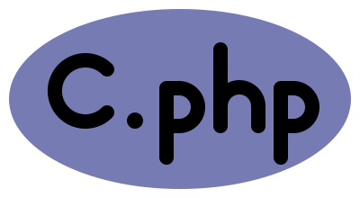

<p align="center"></p>

# c.php

> C's preprocessor is bare-minimum. Use PHP instead.

Write C with embedded PHP in `*.c.php` (and `*.h.php`) files. A CMake step expands them before the compiler runs, and a VS Code extension gives you diagnostics, hover, go-to-definition and completion for both languages in the same file.

> **Status: pre-alpha.** The expander, CMake functions, PHP sharing, Composer support and the VS Code extension work, and CI is green on Linux, macOS and Windows. The extension is not published yet (install it from a `.vsix`), and it has only been exercised in VS Code on macOS. See [`remaining_tasks/`](remaining_tasks/REMAINING_TASKS.md).

## Quick start

```cmake
include(FetchContent)
FetchContent_Declare(cphp
  GIT_REPOSITORY https://github.com/RechieKho/c.php
  GIT_TAG        main)  # pin to a release tag once one exists
FetchContent_MakeAvailable(cphp)

add_executable(app main.c)
cphp_add_sources(app table.c.php)
```

`table.c.php`:

```c
#include "table.h"

<?php $ops = ['add' => '+', 'sub' => '-', 'mul' => '*']; ?>
<?php foreach ($ops as $name => $sym): ?>
int op_<?= $name ?>(int a, int b) { return a <?= $sym ?> b; }
<?php endforeach ?>
```

Build as usual. The template expands to `<build>/cphp/table.c`, which is compiled into `app`. Any C file in the target can call `op_add`, `op_sub` and `op_mul`.

**Requirements:** CMake >= 3.20, PHP >= 8.0 CLI, a C compiler. Editor tooling also needs clangd and, for PHP features, a PHP language server (Intelephense by default, or Phpactor).

## How it works

- `cphp_add_sources(target files...)` runs the expander (`bin/cphp.php`) on each template at build time and adds the output to the target. A depfile makes edits to included PHP rebuild correctly.
- Compiler errors and debugger steps point at `table.c.php`, not the generated file, through `#line` directives and a source map (see [docs/DEBUGGING.md](docs/DEBUGGING.md)).
- Templates are not auto-formatted; clang-format would corrupt the PHP ([docs/FORMATTING.md](docs/FORMATTING.md)).
- Expanding a template runs arbitrary PHP. Only build code you trust.

**Generated headers:** `cphp_add_sources(lib gen/limits.h.php)` expands to `<build>/cphp/gen/limits.h`, includable as `"gen/limits.h"` inside `lib`. `cphp_export_headers(lib)` also exposes it to targets that link `lib` and installs it under `include/`.

## Sharing PHP between projects

```cmake
# producer
add_library(mylib ...)
cphp_export_php(mylib DIRECTORY php NAME mylib)

# consumer: link first, then add templates
target_link_libraries(app PRIVATE mylib)
cphp_add_sources(app main.c.php)
```

In a template: `<?php require_once cphp('mylib/macros.php'); ?>`. Works with FetchContent and with installed packages (`find_package`).

## Composer packages

```cmake
cphp_use_composer(app)               # app/composer.json (+ any linked library that also calls it)
cphp_add_sources(app main.c.php)     # templates can use the packages
```

Create the lock once with `-DCPHP_COMPOSER_UPDATE=ON` and commit `composer.lock`. Needs Composer on `PATH`.

## Editor support

The VS Code extension lives in [`editor/vscode/`](editor/vscode/). It starts an LSP proxy that gives clangd a C "shadow" of each template (PHP blocks blanked out) and a PHP language server a PHP shadow (C text blanked out), then maps results back to the template.

What works in VS Code:

- Syntax highlighting for C and PHP in one file, plus build problem matchers for GCC, MSVC and PHP errors.
- C diagnostics, hover, go-to-definition, document symbols and semantic tokens through clangd; PHP hover, completion and diagnostics through Intelephense (opt-in install offered on first use).
- Go-to-definition from plain `.c`/`.h` files lands on the template, and from `<?= ?>`-built names (`op_<?= $name ?>`) lands on the generated definitions.
- Multi-root workspaces (one client per folder) and `cphp('lib/file.php')` navigation.

Install a `.vsix` built with `npm run package` in `editor/vscode/` (or from a release) via **Extensions: Install from VSIX...**, only from sources you trust. `cphp_setup_vscode()` in CMake adds the extension to `.vscode/extensions.json` and, with `INSTALL`, installs it through the `code` CLI (the extension is not published yet, so that install warns for now).

Settings: `cphp.buildDirectory`, `cphp.clangdPath`, `cphp.clangdArgs`, `cphp.phpPath`, `cphp.phpServer`, `cphp.phpServerArgs`, `cphp.serveCFiles`, `cphp.disableCppIntelliSense`, and the `cphp.restart` command.

Neovim, Helix and Zed setups (written, untested): [docs/EDITORS.md](docs/EDITORS.md).

## Gotchas

- Names built by PHP (`<?= $name ?>_init()`) show as placeholders in the live editor view; real diagnostics arrive after a build.
- Keep C braces balanced within each PHP branch.
- `return <?= $sym ?> b` (a unary operator from PHP) shows a false C error in the editor.
- With C/C++ (cpptools) IntelliSense enabled, VS Code also lists its own go-to-definition result; the extension offers to disable it for the workspace.
- More in [`state/STATE.md`](state/STATE.md).

## Docs

- [Architecture spec](architecture/ARCHITECTURE_SPEC.md)
- [Current state, TODOs and gotchas](state/STATE.md)
- [Remaining tasks](remaining_tasks/REMAINING_TASKS.md)
- [Debugging](docs/DEBUGGING.md), [formatting](docs/FORMATTING.md), [other editors](docs/EDITORS.md)

## Development

```sh
cmake -S . -B build -DCPHP_BUILD_EXAMPLES=ON
cmake --build build
ctest --test-dir build
```

The editor is a single npm project in `editor/vscode/` (`npm run build`, `npm test`, `npm run package`); run npm from there, never from the repo root.

## License

[MIT](LICENSE)
